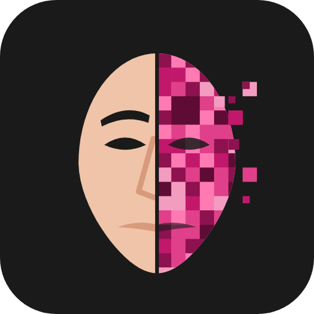

[](https://x.com/NorowaretaGemu)

<div align="center">
  <a href="https://ko-fi.com/cursedentertainment">
    
  </a>
</div>

<p align="center"></p>

# Changeling Studio

**Website:** https://cursedprograms.github.io/Changeling-Studio/

Every Changeling in one place. Each Changeling is its own program and its own repo; Studio keeps them side by
side in one folder, so you work from here as if they were all one project, and (coming) runs them in one
window, with **chains**: CopyCat Realtime > Chronos > Cosmetics > Echo, each adding to the last, live or on photos.

| Changeling | What it does |
| --- | --- |
| [CopyCat](https://github.com/CursedPrograms/Changeling-CopyCat) | one face onto any photo or video (grown from roop, AGPL-3.0) |
| [CopyCat Realtime](https://github.com/CursedPrograms/Changeling-CopyCat-Realtime) | the face swap live on the webcam for video calls, with a female/male voice and recording |
| [Tiresias](https://github.com/CursedPrograms/Changeling-Tiresias) | gender swap for photos |
| [Chronos](https://github.com/CursedPrograms/Changeling-Chronos) | age a face forwards or backwards, or a five-age timeline |
| [Cosmetics](https://github.com/CursedPrograms/Changeling-Cosmetics) | makeup, hair colour and length, beards, on two layers |
| [Echo](https://github.com/CursedPrograms/Changeling-Echo) | train the voices the Changelings speak with (RVC, from Piper or your own recordings) |

## Get them all

```
fetch.bat        # Windows
.\fetch.ps1      # PowerShell
./fetch.sh       # Linux / macOS / Git Bash
```

Each Changeling in `apps.txt` is cloned into its own folder here if it's missing, and pulled if it's here.
Studio's `.gitignore` leaves those folders out, so each one still commits and pushes to its own repo. Then start
any of them with its own `run.bat` / `run.ps1` / `run.sh`. Where they use the same models (Tiresias and Chronos
share StyleGAN2 and the face finders), the later one borrows the first one's files instead of downloading them
again.

## Coming

- **Studio itself:** one window with every Changeling as a tab.
- **Chains:** run several in a row (CopyCat Realtime > Chronos > Cosmetics), live or on a photo.
- **A basic editor everywhere:** brightness, contrast, saturation, warmth, vignette, sharpen, on two layers.
- **Realtime versions** of every Changeling, each its own repo; **run_server**: a Flask server with a QR code,
  so a phone's camera and microphone can be the input while the PC does the work.
- **Whole-photo results with the hair cleaned up** (inpainting the leftover hair outside the face frame).

## The look

Every Changeling's site uses `site/changeling.css` and `site/family.js` from here (Studio's Pages), so they look
the same and a change here shows on all of them: the apps' own dark greys and the Cursed pink, solid colours, no
gradients, no shadows. `family.js` draws the family list on every site: a new Changeling is added there once.
`site/make_logo.py` draws the logo (`site/logo.svg`, `site/icon.svg`), after Gemini's sketch.

---

<br>
<div align="center">
© Cursed Entertainment 2026
</div>
<br>
<div align="center">
<a href="https://cursed-entertainment.itch.io/" target="_blank">
    
</a>
</div>
<br>
<div align="center">
  <a href="https://github.com/SynthWomb" target="_blank">
    
  </a>
</div>
